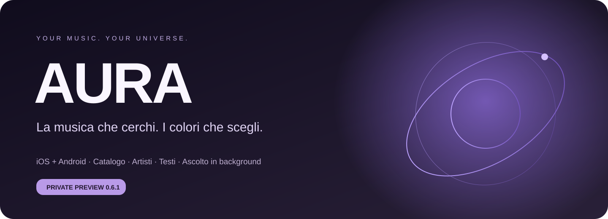
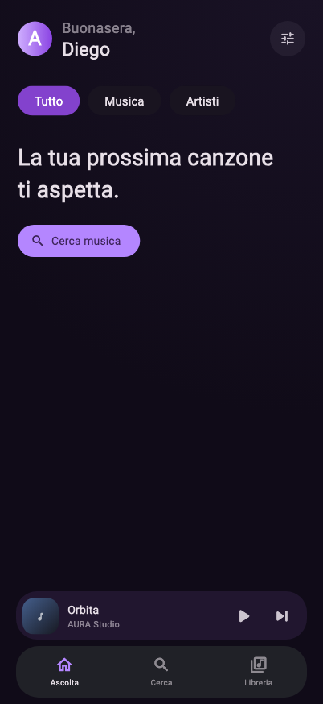
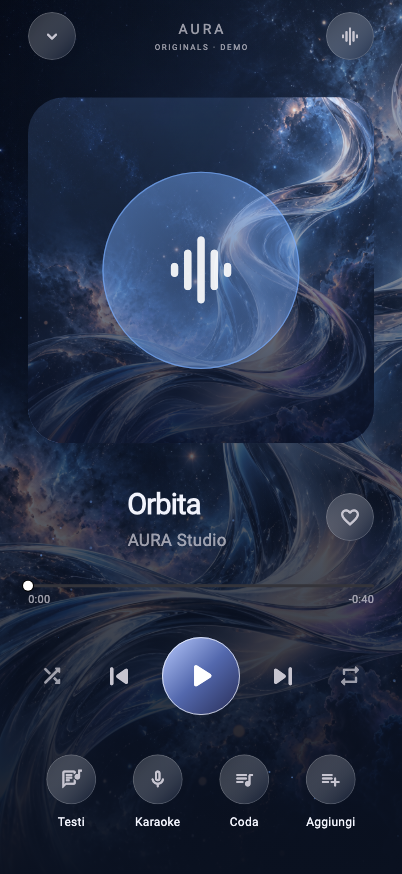
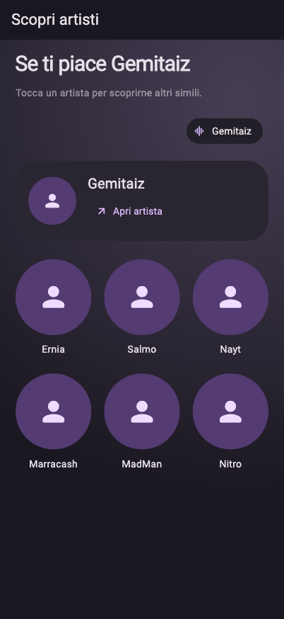
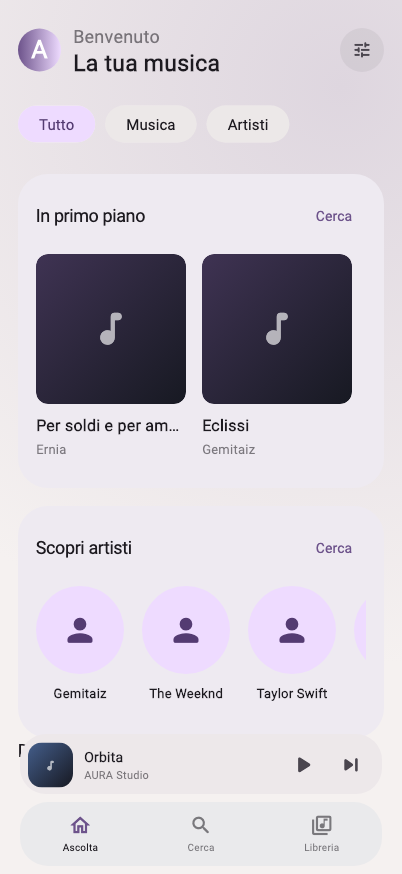
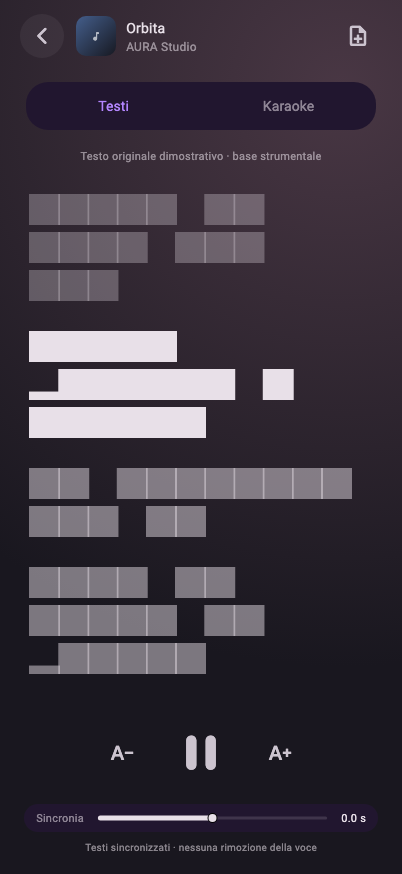

<div align="center">



**Un’esperienza musicale personale, tra scoperta e ascolto.**

[Scarica la release](https://github.com/DiegoMazzei/aura/releases/tag/v0.6.1) · [Installazione](docs/INSTALLAZIONE.md) · [Novità](CHANGELOG.md) · [Sicurezza](SECURITY.md)


</div>

## La tua musica, il tuo spazio

Cerca un brano, entra nella discografia di un artista e segui le connessioni con
altri musicisti. AURA riunisce catalogo, ascolto e libreria personale in
un’interfaccia dai colori personalizzabili.

| Scopri | Ascolta | Rendi tua AURA |
| :--- | :--- | :--- |
| Ricerca di brani, artisti e album | Riproduzione in background e controlli di sistema | Colori e profilo personale |
| Discografie ed edizioni raggruppate | Coda che mantiene l’ordine dell’album | Preferiti e playlist locali |
| Esplorazione degli artisti simili | Testi e karaoke quando sincronizzati | Artisti seguiti scelti da te |

## Download · 0.6.1

| Piattaforma | File | Come si usa |
| :--- | :--- | :--- |
| **Android 7+** | [Scarica APK](https://github.com/DiegoMazzei/aura/releases/download/v0.6.1/AURA-0.6.1-Android.apk) | Installazione manuale; build di prova con firma di sviluppo |
| **iOS** | [Scarica IPA da firmare](https://github.com/DiegoMazzei/aura/releases/download/v0.6.1/AURA-0.6.1-iOS-unsigned.ipa) | Richiede firma e provisioning; non è installabile direttamente dal download |
| **Integrità** | [SHA256](https://github.com/DiegoMazzei/aura/releases/download/v0.6.1/SHA256SUMS.txt) | Verifica i file scaricati |

Il repository e i download sono **privati**: serve un account GitHub autorizzato.
Per iOS non è ancora disponibile una distribuzione TestFlight.
[Leggi le istruzioni complete](docs/INSTALLAZIONE.md).

## Dentro l’interfaccia

Queste immagini sono render dei **widget reali dell’app**, prodotti dai test
visivi della versione 0.6.1 con dati dimostrativi. Non sono mockup né catture
da un telefono: fotografie e copertine di rete non sono caricate nei test e
compaiono i segnaposto. I materiali nativi iOS dipendono dal sistema operativo.
I brani demo visibili sono fixture di test e non un catalogo precaricato per l’utente.

<table>
<tr><th>Home · Scoperta</th><th>Player · Ascolto</th><th>Artisti · Connessioni</th></tr>
<tr><td></td><td></td><td></td></tr>
</table>

<details>
<summary>Tema chiaro e karaoke</summary>

<table><tr><td></td><td></td></tr></table>

</details>

## Cosa è disponibile

- Catalogo e ricerca: metadati di artisti e album distinti dalla cronologia degli ascolti.
- Preferiti: ascoltare un artista non lo aggiunge automaticamente agli artisti seguiti.
- Riproduzione: selezione automatica della registrazione e scaletta contestuale dell’album.
- Testi: sincronizzazione quando fornita da LRCLIB; consultazione esterna su Genius.
- Spotify: importazione predisposta con PKCE, richiede un proprio Client ID; nessun Client Secret.
- iOS: superfici native dove supportate e controlli di riproduzione di sistema.

Copertura del catalogo, immagini, testi e disponibilità della riproduzione
dipendono dai servizi esterni. La Home personalizzata in sviluppo e la Jam
non sono incluse in questa release. AURA non è affiliata ai servizi citati.

## Sviluppo

Richiede Flutter compatibile con Dart `^3.13.7`, Xcode per iOS e Android SDK/JDK per Android.

```sh
flutter pub get
flutter analyze
flutter test
flutter run
```

Android: `flutter build apk --release`. Configura una firma di produzione prima
di distribuire sul Play Store. iOS: apri `ios/Runner.xcworkspace`, scegli il tuo
Team e un bundle identifier univoco; lo snapshot usa `org.example.aura`.

Per Spotify registra il callback `org.example.aura.spotify://callback` e mantieni
coerenti configurazione nativa e Dart. Configura un contatto reale nel User-Agent
del client metadati. [Guida Spotify](docs/SPOTIFY_SETUP.md) · [Architettura](docs/ARCHITECTURE.md).

## Privacy e stato del progetto

Nome del profilo, preferiti e cronologia sono memorizzati localmente; i provider
ricevono le richieste di ricerca e rete. I token Spotify vengono usati in memoria
per l’importazione. I dati locali non hanno una cifratura aggiuntiva dell’app;
Android mantiene il comportamento di backup predefinito del sistema.

Questo repository nasce da una copia ripulita dei sorgenti: non include la
vecchia cronologia, librerie dei dispositivi, chiavi, certificati o profili Apple.
L’APK di prova già compilato conserva gli identificatori dello sviluppatore,
come spiegato nella guida. Non è stato eseguito un audit di sicurezza completo.

Il codice AURA non ha ancora una licenza di redistribuzione assegnata.
Le licenze dei componenti di terze parti, del font Roboto e della copia modificata
di `just_audio` sono conservate. [Sicurezza](SECURITY.md) · [Storia del progetto](CHANGELOG.md).
