# AURA · Galleria dei temi

Sedici catture reali della Home: gli otto colori predefiniti in tema scuro e
chiaro. Tema e accento sono stati cambiati nelle impostazioni dell’app sul
simulatore iPhone; alle schermate non sono applicati filtri di colore.
Le immagini sono ridimensionate e compresse per il web.

[Prova la vetrina animata](https://diegomazzei.github.io/AURA/#aspetto).
Nell’app è disponibile anche un selettore di colore personalizzato, oltre agli otto preset.

<table><tr><th>Colore</th><th>Scuro</th><th>Chiaro</th></tr>
<tr><td>Viola</td><td>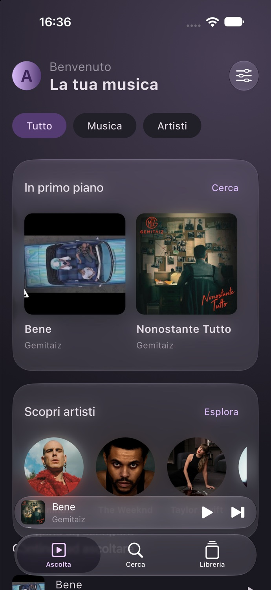</td><td>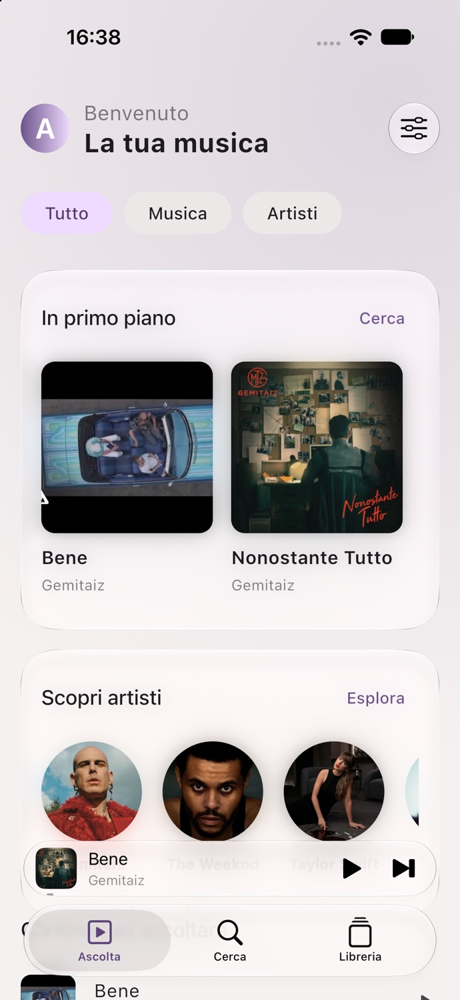</td></tr>
<tr><td>Blu</td><td>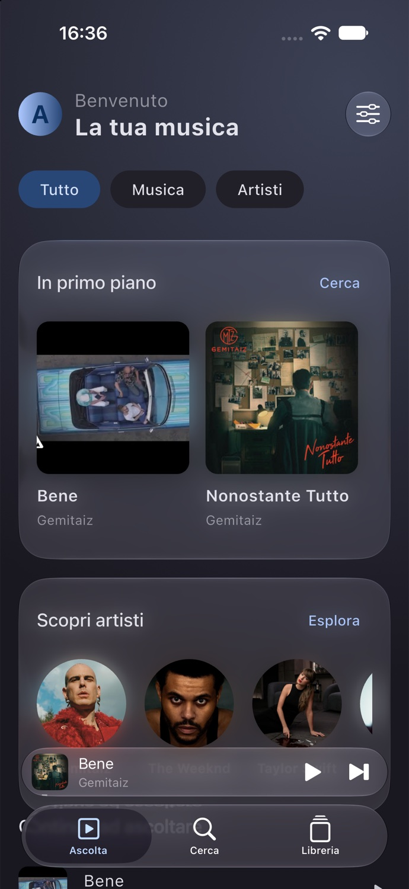</td><td></td></tr>
<tr><td>Turchese</td><td>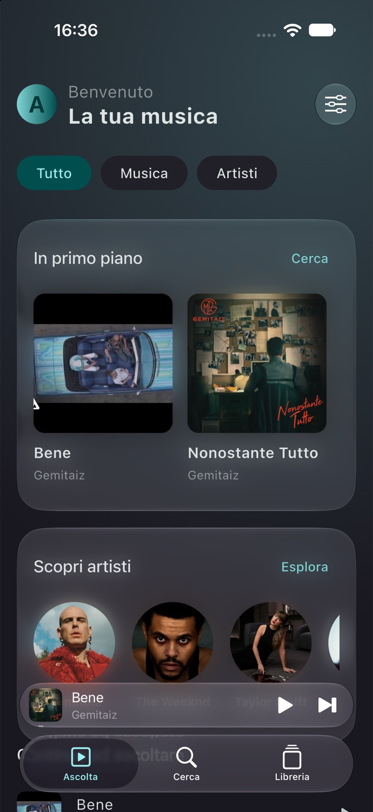</td><td>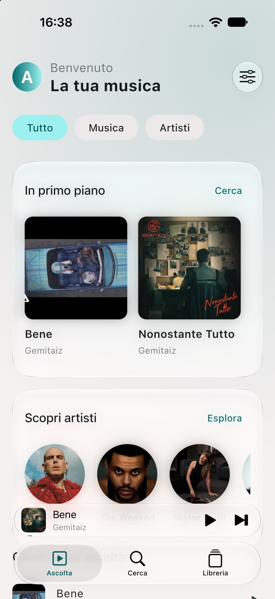</td></tr>
<tr><td>Verde</td><td>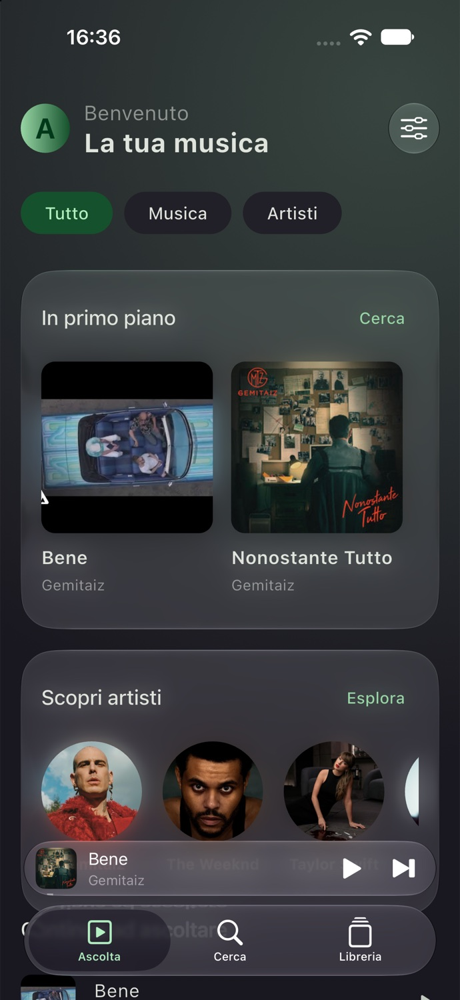</td><td>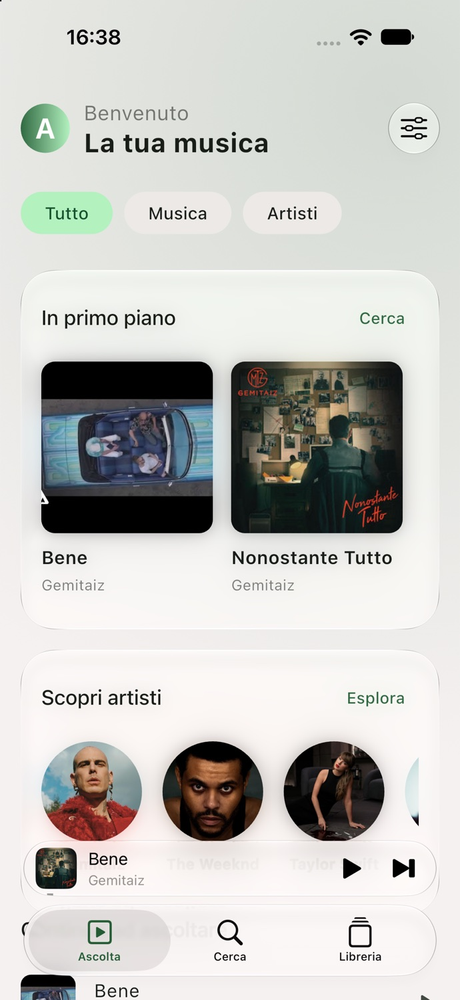</td></tr>
<tr><td>Rosa</td><td>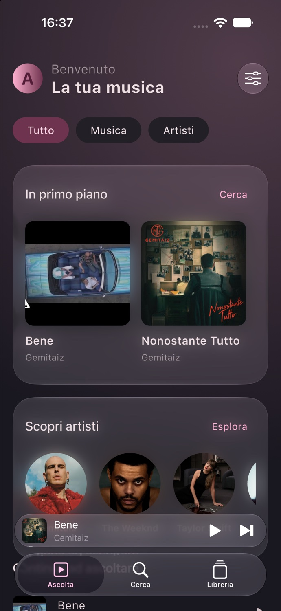</td><td>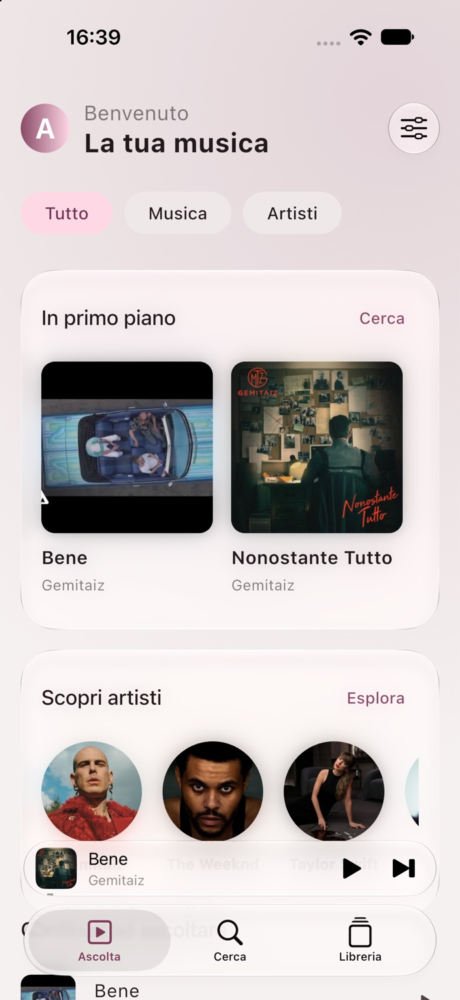</td></tr>
<tr><td>Corallo</td><td>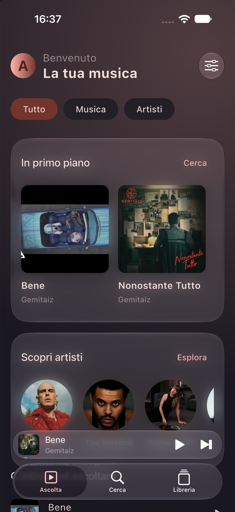</td><td>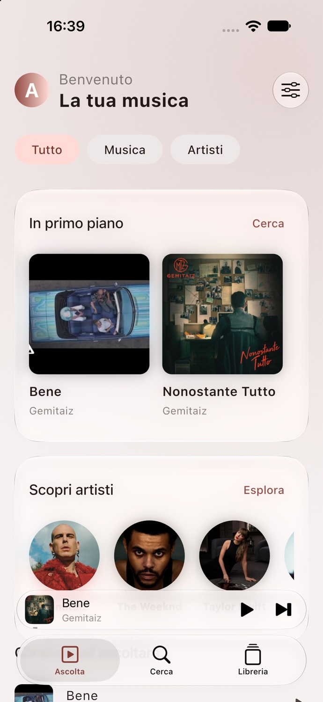</td></tr>
<tr><td>Ambra</td><td>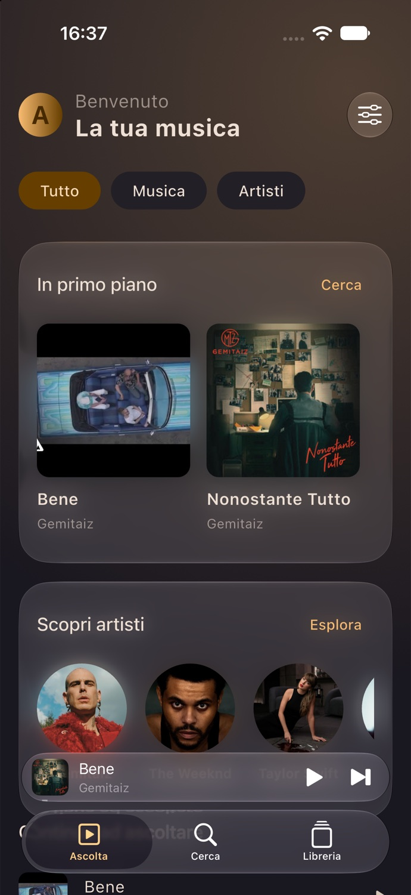</td><td>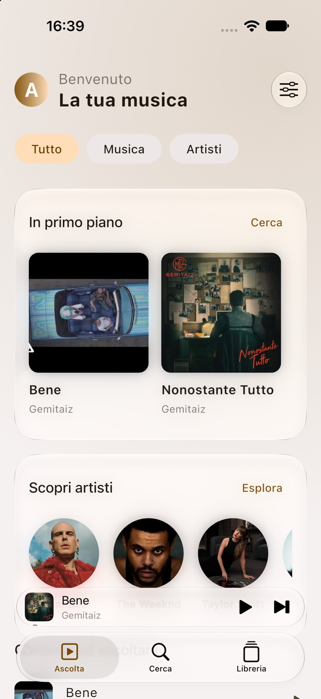</td></tr>
<tr><td>Grafite</td><td>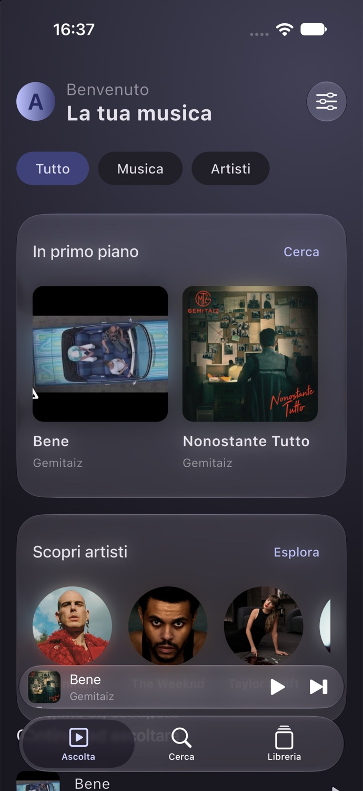</td><td>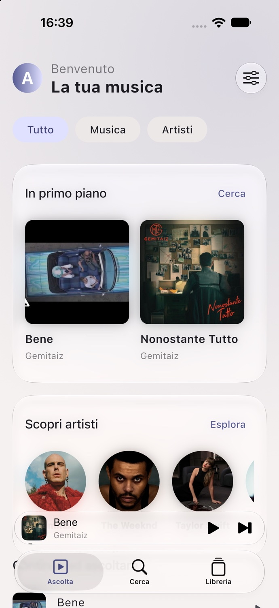</td></tr>
</table>

Le cornici dei dispositivi sul sito sono illustrative. Il materiale nativo iOS
può differire dalla versione Android. Copertine e foto appartengono ai rispettivi titolari.
